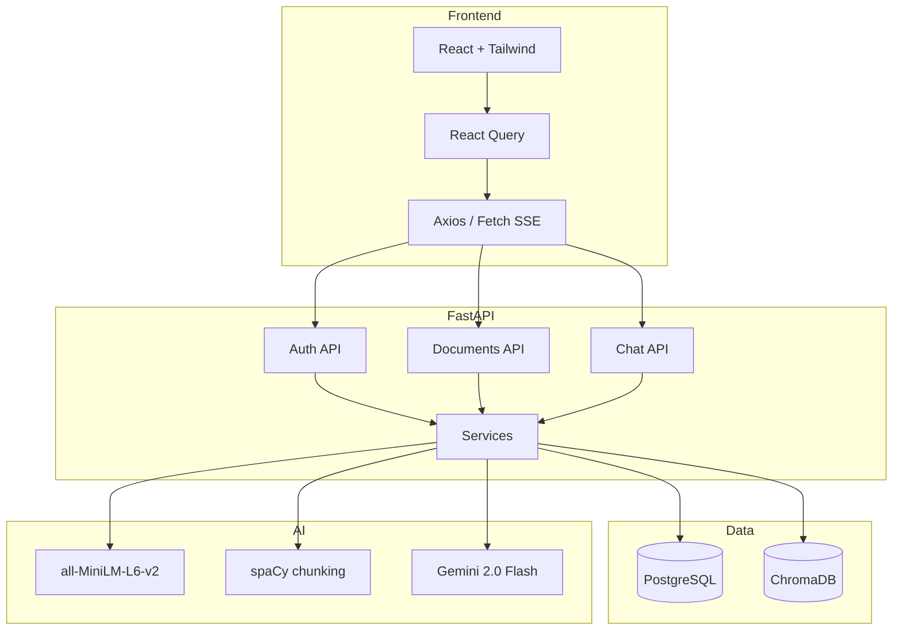
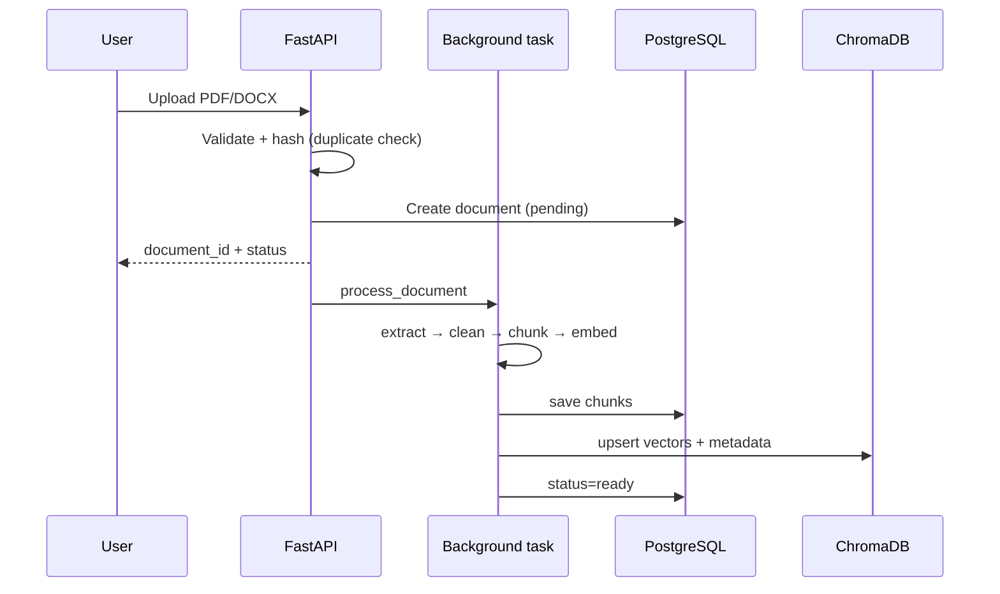
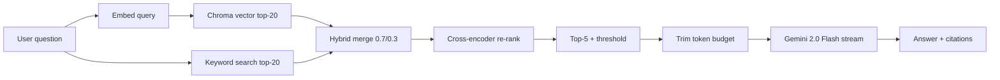

# Architecture

## System overview



## Ingestion pipeline



## Retrieval + RAG



## Data ownership

Every document, chunk, conversation, and message is scoped to the authenticated `user_id`.  
Chroma metadata includes `user_id` and `document_id` for filtered retrieval.

## LLM provider abstraction

```
services/llm/base.py          → LLMProvider interface
services/llm/gemini_service.py → Gemini 2.0 Flash (primary)
services/llm/deepseek_service.py → optional fallback
```

Switch with `LLM_PROVIDER=gemini|deepseek`.
